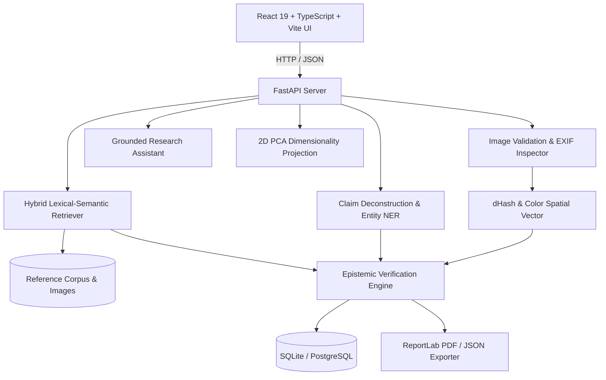

# TRUTHLENS Architecture Specification

## Overview

TRUTHLENS is an AI-powered visual misinformation investigation platform structured as a decoupled full-stack system. It implements forensic image analysis, grounded document retrieval, claim deconstruction, and epistemic verification.

## Subsystem Details

### 1. Ingestion & Forensics
- **EXIF Inspector**: Parses camera device, lens, software tags, and timestamps.
- **GPS Privacy Redactor**: Converts DMS coordinates into privacy-safe approximate strings; never stores exact unredacted GPS publicly.
- **Privacy Stripper**: Employs Pillow to recreate clean bitmaps and purge all headers for downloadable sanitized copies.

### 2. Retrieval Engine
- **Perceptual Vector Distance**: Computes Hamming distance over 64-bit difference hashes (dHash) to locate archival photo reuses.
- **Lexical-Semantic Ranking**: Uses TF-IDF with unigram/bigram tokenization and entity overlap bonuses to rank passages from verified fact-checks and official bulletins.

### 3. Epistemic Verification Engine
- Decouples image authenticity from claim accuracy:
  - **Supported**: Both visual match and grounded documentation corroborate time, place, and event.
  - **Contradicted**: Evidence establishes spatial/temporal misattribution (e.g., 2019 Mumbai photo shared as 2026 Pune flood) or synthetic generation.
  - **Insufficient Evidence**: Explicit abstention when matching documentation is absent; avoids assuming unproven claims are false.
  - **Conflicting**: Explicit handling when reputable sources diverge.
