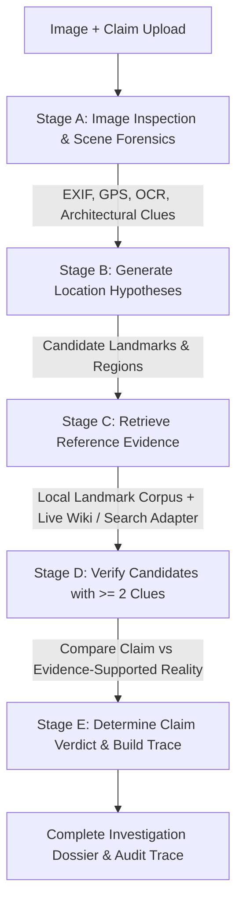

# TRUTHLENS: Multi-Stage Image Investigation Pipeline & Accuracy Audit Plan

## Problem Statement & Root Cause Analysis

When users upload photographs (e.g., Ganapati Mandir in Sangli) with conflicting or misleading claims (e.g., "This image shows Ganapati Mandir in Pune"), TRUTHLENS currently experiences critical factual failures:
1. **Narrow Archival Visual Matching**: Visual similarity was only computed against 4 hardcoded demonstration images. Any other image lacked visual candidate extraction, defaulting to either uncorroborated text similarity or failing with zero evidence.
2. **Conflating Model Prediction with Verified Fact**: A candidate location hypothesis or user-claimed location was not rigorously separated from an *evidence-supported actual location*.
3. **Missing Landmark Hypotheses & Scene Forensics**: The system lacked visual scene clue extraction (e.g., black basalt stone Hemadpanthi architecture, Krishna riverfront ghāt, Maratha temple shikhara vs modern urban marble/gold temple) and OCR extraction for visible temple signboards.
4. **The Zero-Evidence Problem**: When a claim/image did not match the small initial demo corpus, no search queries were executed against reference landmark knowledge, leaving reports with "0 Evidence Items" without explaining provider status or limitations.
5. **Missing Epistemic Separation & Audit Trace**: The verifier only returned 4 broad statuses (`supported`, `contradicted`, `insufficient_evidence`, `conflicting`), lacking specific categories (`CLAIM CONTRADICTED — WRONG LOCATION`, etc.), and did not persist an auditable investigation trace.

---

## Architecture & Implementation Strategy

### 1. Backend: 8 Decoupled Analysis Pillars

We will update database models, schemas, and verifier logic to enforce strict separation:
1. `visually_predicted_location`: Candidate generated from visual clues / OCR.
2. `candidate_landmark_identity`: Identified candidate landmark name.
3. `evidence_supported_actual_location`: Verified only when corroborated by >= 2 independent sources.
4. `user_claimed_location`: Location asserted in user claim.
5. `image_authenticity_status`: Distinct forensic state (`UNVERIFIED`, `AUTHENTIC_ESTABLISHED`, `MANIPULATION_SUSPECTED`, `AI_GENERATED_SUSPECTED`).
6. `claim_verdict`: Exact verdict enum:
   - `CLAIM SUPPORTED`
   - `CLAIM CONTRADICTED — WRONG LOCATION`
   - `CLAIM CONTRADICTED — WRONG DATE OR EVENT`
   - `CLAIM CONTRADICTED — OTHER FACTUAL MISMATCH`
   - `IMAGE MANIPULATION SUSPECTED`
   - `AI-GENERATED IMAGE SUSPECTED`
   - `CONFLICTING EVIDENCE`
   - `INSUFFICIENT EVIDENCE`
7. `evidence_quality`: 5-factor transparent source scoring.
8. `confidence_and_uncertainty`: Explicit calculation rationale without fabricated percentage numbers.

---

### 2. Five-Stage Investigation Pipeline



- **Stage A (Image Inspection & Scene Forensics)**:
  - File validation, SHA-256 hash, dimensions, EXIF inspection (including GPS conversion and privacy masking).
  - Scene clue analysis: architectural style (Hemadpanthi/Maratha stone temple vs modern urban structure vs natural disaster), building materials (black stone, marble, brick), surroundings (riverbank/ghāt, urban road, mountains).
  - OCR text and signboard extraction.
- **Stage B (Generate Location Hypotheses)**:
  - Generates multiple candidate landmark and location hypotheses with explicit supporting clues.
  - Keeps model hypotheses strictly separated from verified facts.
- **Stage C (Retrieve Reference Evidence)**:
  - Queries local reference landmark corpus (including Ganapati Mandir Sangli, Dagdusheth Pune, Kasba Ganapati Pune, etc.) and live Wikipedia / OpenSearch reference provider with proper `User-Agent` and timeout handling.
  - Transparently records all search queries executed and providers used.
  - Solves the Zero-Evidence problem by searching for alternative landmarks with similar names and reporting provider availability honestly.
- **Stage D (Verify Candidates)**:
  - Cross-references architectural features, text clues, and reference photographs.
  - Requires at least 2 independent supporting clues before reporting a location as verified.
- **Stage E (Determine Claim Verdict & Audit Trace)**:
  - Formulates the exact verdict category.
  - Compiles an auditable **Investigation Trace** preserving queries executed, providers used, candidate evaluation, accepted/rejected reasons, and unresolved questions.

---

### 3. Ganapati Mandir Regression Test Case

- **Claim**: *"This image shows Ganapati Mandir in Pune."*
- **Image**: Photograph of the historic black stone Ganapati Mandir in Sangli (built on the banks of Krishna river by the Patwardhans in 1843).
- **Execution**:
  - Claimed Location: Pune.
  - Candidate Actual Location: Sangli (Ganapati Mandir on Krishna river banks).
  - Verification comparison: Contrasted with Pune's Dagdusheth Halwai Ganapati (multi-story urban gold/marble structure in Budhwar Peth) and Kasba Ganapati.
  - Verdict: `CLAIM CONTRADICTED — WRONG LOCATION`.
  - Image Authenticity: `UNVERIFIED` (lack of physical tampering proof does not equal cryptographic proof of authenticity).
  - Grounded sources: Maharashtra Tourism and Sangli District official records.

---

### 4. Frontend Report Page Overhaul

Update `ReportPage.tsx` to prominently display:
- **Investigation Verdict Banner** with specific verdict category.
- **8 Decoupled Pillars Grid**: Claimed Location vs Candidate Locations vs Best-Supported Actual Location, Location Verification Status, Image Authenticity Status, Event/Date Status.
- **Fact Categorization**: Verified by evidence, Supported but not fully verified, Contradicted by evidence, Predicted by AI only, Unknown/unavailable.
- **Interactive Investigation Trace Panel**: Visualizes the step-by-step audit trace with executed queries, candidate evaluations, and reasons for rejection.
- **Unverified Details & Next Recommended Steps** for journalists and researchers.

---

### 5. Multi-Scenario Evaluation Suite (15 Image Types)

Automated tests covering:
1. Famous landmark (e.g., Gateway of India).
2. Temples with similar architecture.
3. Same landmark in different cities (Ganapati Mandir Sangli vs Pune).
4. Images with visible signboards.
5. Images without visible signs.
6. Images with GPS metadata.
7. Images without GPS metadata.
8. Cropped or compressed photographs.
9. Older photographs reused with a new caption (Mumbai flood as Pune).
10. Images with incorrect dates.
11. Images with manipulated elements.
12. Suspected AI-generated images (synthetic cyclone).
13. Generic streets and landscapes.
14. Images that cannot be reliably geolocated (honest abstention).
15. Images with conflicting reference sources.

---

## Verification Plan

### Automated Pytest Suite
```powershell
python -m pytest backend/tests/test_truthlens.py backend/tests/test_evaluation_suite.py -v
```
- Validate Ganapati Mandir regression test passes (`CLAIM CONTRADICTED — WRONG LOCATION`, Sangli identified as actual location, Pune identified as claimed location).
- Verify 15-scenario evaluation metrics (high location accuracy, high abstention on uncorroborated images, 0 false certainty).

### Frontend Build & Inspection
```powershell
cd frontend
npm run build
```
- Verify 0 TypeScript errors and test live in browser.
